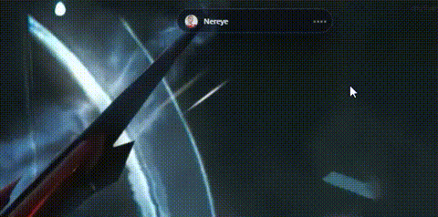
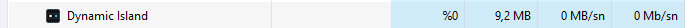
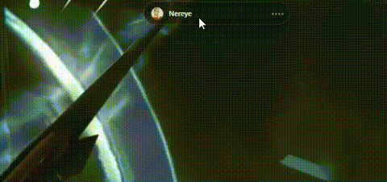
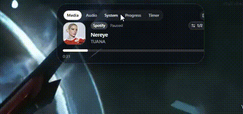
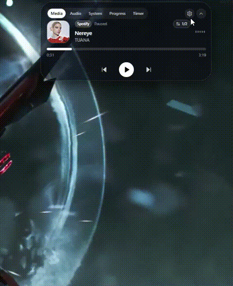
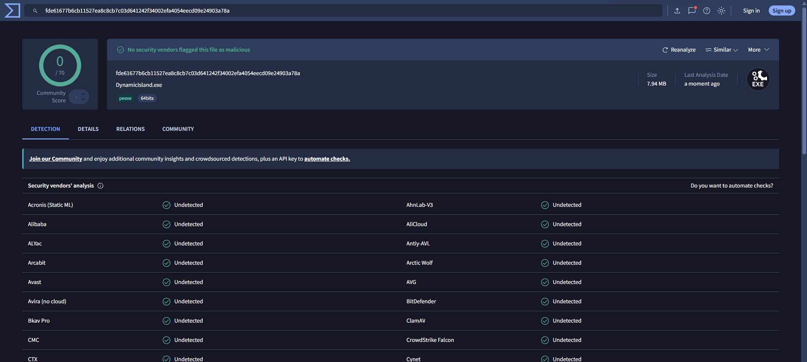

# Dynamic Island for Windows 10/11

[](https://github.com/TuniMani/dynamic-island-win)
[](https://v2.tauri.app/)
[](https://www.rust-lang.org/)
[](./LICENSE)

A lightweight, native-feeling **Dynamic Island** desktop overlay for **Windows 10 & Windows 11**. Built with **Tauri v2**, **Win32/WinRT**, **React**, **TypeScript**, **Tailwind CSS**, and **Framer Motion**, it brings fluid spring animations, live media playback controls, background task progress, system HUDs, and a file dropzone to your Windows desktop without ever stealing focus from games or active windows.



---

## ⚡ Ultra-Lightweight Performance

Engineered in Rust to run silently in the background with virtually zero resource usage (~**0% CPU** and **9.2 MB RAM**):



---

## ✨ Live Preview & Features

### 1. Instant Media Controls & Source Switching (Spotify, YouTube & More)


### 2. Multi-Tab Overview (Media, System, Progress & Timer)


### 3. Deep Customization & Multi-Language Settings


---

## Key Features

- **Zero Focus Stealing (`WS_EX_NOACTIVATE`)**: Interacting with or clicking the island never steals foreground focus from fullscreen/borderless games, browsers, or editors, and areas outside the visible pill are click-through.
- **Live Media Controls & Visualizer (Windows SMTC)**:
  - Integrates with Windows System Media Transport Controls (Spotify, Chrome, Edge, Apple Music, Brave, VLC, etc.).
  - Compact album art + GPU-accelerated audio spectrum bars reacting to real-time system audio peaks.
  - Expanded view with track metadata, seekable timeline, instant source switching, inline per-app volume control, and Play/Pause/Next/Previous controls.
  - **Toggleable Media Volume Bar**: Turn off **Show Media Volume Bar** in Settings to hide the inline per-app volume slider for a more compact Media card while keeping the seek bar and playback controls intact.
- **Background Progress Tracking**:
  - Tracks Explorer file copy/move dialogs (`OperationStatusWindow`), classic progress dialogs (`msctls_progress32`), and taskbar button progress (`ITaskbarList3` via UIAutomation) with a circular progress ring.
- **System Resource Monitor & Countdown Timer**:
  - Real-time CPU, RAM, and battery/AC power status.
  - Built-in countdown timer with quick presets (`1m`, `5m`, `10m`, `25m`) and compact pill readout.
- **Event-Driven Volume & Brightness HUD**:
  - Automatically pops open when system volume (`IAudioEndpointVolumeCallback`) or screen brightness (`WmiMonitorBrightnessEvent` / DDC/CI) changes.
- **Drag & Drop File Dropzone**:
  - Drag files from Explorer onto the island to copy files directly to the Windows clipboard (`CF_HDROP`), copy file paths, or create a `.zip` archive with live progress.
- **Deep Personalization & Multi-Language (`en` / `tr`)**:
  - Instant **English** (default) and **Turkish** switching without restart.
  - Quick presets (`Top Center`, `Top Left`, `Top Right`, `Bottom Center`), multi-monitor support, X/Y fine offsets, and **Unlock Position (Drag to Move)**.
  - Adjustable scale (`75%–140%`), corner radius (`16px` card to full pill), `Pure Black (OLED)` / `Glassmorphism` / `Custom Opacity`, Dynamic Album or custom Accent Color, and spring animation speed.
  - Smart behavior rules: auto-collapse on outside click / focus loss, configurable mouse-leave delay, hover/click trigger, **Start with Windows**, **Auto-hide in Fullscreen**, **Auto-hide when idle**, and modular tab toggling/reordering.

---

## Quick Start (Standalone `.exe`)

1. Go to the [**Releases**](https://github.com/TuniMani/dynamic-island-win/releases) page and download **`DynamicIsland.exe`**.
2. Double-click **`DynamicIsland.exe`** — it starts silently in the background with no console window and registers a **System Tray** icon.
3. Left-click or right-click the tray icon to open **Settings**, toggle visibility, reset position, or **Quit**.

## 🛡️ Security & VirusTotal Verification

Verified release executable scan report:
- 🔗 [View VirusTotal Report](https://www.virustotal.com/gui/file/1a89f6226cee2ef70be44f462787d8356ca236e89483bdda49fa0448678cbb92?nocache=1)



---

## Building from Source

### Prerequisites
- **Windows 10 / 11** (WebView2 Runtime — pre-installed on Windows 11)
- **Node.js** 18+ and **npm**
- **Rust** (stable `x86_64-pc-windows-msvc` toolchain) & **Visual Studio Build Tools (MSVC + Windows 10/11 SDK)**

### Development Mode
```bash
npm install
npm run tauri dev
```

### Fast Standalone Release `.exe` Build
```bash
npm run build
npx tauri build --no-bundle
```

The standalone executable will be generated at:
`src-tauri/target/release/dynamic-island-win.exe`

You can also use the included PowerShell helper:
```powershell
.\build-exe.ps1
```

---

## Architecture Overview

- **`src-tauri/src/win32_window.rs`**: `WS_EX_NOACTIVATE`, `WS_EX_LAYERED` + `LWA_ALPHA`, adaptive `WS_EX_TRANSPARENT` hit-testing, `WM_MOUSEACTIVATE` subclassing, auto-collapse focus/click detector, fullscreen detection, and free drag handler.
- **`src-tauri/src/smtc.rs`**: WinRT SMTC event listener + conditional `IAudioMeterInformation` peak sampler.
- **`src-tauri/src/audio_brightness.rs`**: Event-driven `IAudioEndpointVolumeCallback` and WMI / DDC/CI brightness monitor.
- **`src-tauri/src/progress_tracker.rs`**: Window/dialog/taskbar progress scanner.
- **`src-tauri/src/dropzone.rs`**: Win32 `CF_HDROP` clipboard integration and streaming ZIP archiver.
- **`src-tauri/src/settings.rs` & `tray.rs`**: JSON persistence, Windows Run registry autostart, lazy Settings window spawner, and localized System Tray.
- **`src/`**: React 19 + TypeScript + Tailwind CSS v4 + Framer Motion UI with i18n (`src/i18n.ts`).

---

## License

Released under the [MIT License](./LICENSE).
